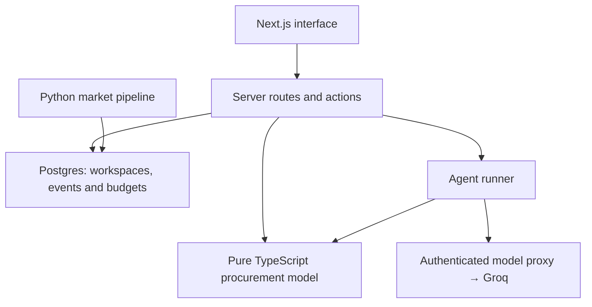

# Bollard

### A procurement workbench for decisions that need evidence.

Bollard brings supplier pricing, contract terms, market inputs and supply risk into one buyer's workflow. Its AI agent plans an investigation, runs procurement tools and returns a recommendation with inspectable evidence. Decisions that would change a negotiating position or share information come back to the buyer for review.

**[Open the app ↗](https://bollard-nine.vercel.app/today)** · [Ask the agent ↗](https://bollard-nine.vercel.app/agents) · [Review decisions ↗](https://bollard-nine.vercel.app/decisions)

> A fictional procurement scenario, built around a €58.3M steel category and a €4.10M savings target. The buyer, suppliers and contracts are demonstration data; modeled savings are not claimed business results.

## The product

The scenario follows Lena Vogt at Halvard Chemie as she prepares for a steel negotiation. She needs to separate a supplier's price claim from its cost drivers, understand alternatives and decide which commitments she is ready to make.

| Workspace | What the buyer can do |
| --- | --- |
| **Today** | See the financial position, open decisions and evidence behind each opportunity. |
| **Agents** | Ask a procurement question and follow the plan, tool calls, answer and figure check as they stream. |
| **Decisions** | Approve, send back with a reason, or undo a decision. |
| **Price asks** | Compare supplier requests against modeled cost movements and contract terms. |
| **Landed cost** | Explore year, import-quota and emissions-data assumptions, including CBAM exposure. |
| **Suppliers** | Inspect spend concentration, supply risk and second-source options. |

**Try it:** ask “What if Ostrava fails?”, inspect the tool results, then review the proposed next step. An approval records a decision in the demo; it sends no supplier message.

## Engineering decisions

### One calculation model for the interface and the agent

Procurement calculations live in pure TypeScript modules: should-cost, landed cost, carbon exposure, contract-index replay and supplier risk. Screens and agent tools call the same functions with the same market inputs.

This keeps the numerical model independent of React and the language model. A separate figure check flags numbers in an answer that cannot be matched to tool results. That check does not establish whether the recommendation itself is sound.

### An agent with a constrained tool boundary

The server streams a run as NDJSON: **plan → tools → answer → figure check**. Plans and answers pass through schemas; tool names come from a registry and tool arguments are validated before execution.

The model can request a proposal. The server rebuilds the decision from trusted application data rather than accepting a client-supplied decision object. Each question is evaluated from its own tool results, making the run inspectable without relying on hidden conversation history.

### Decisions bound to the content the buyer reviewed

Approvals and send-backs carry a digest of the decision text shown to the buyer. The server checks that digest against its own decision before recording the answer.

Decision events are append-only. Undo appends a new event instead of erasing the previous one. Database constraints and triggers enforce those properties alongside the application service.

### Visitor isolation without an account wall

Each visitor receives an HMAC-signed, HttpOnly session cookie identifying a separate workspace. Server routes and actions re-check the session and scope stored decisions and proposals to that workspace.

This makes the public demo usable immediately. It remains an anonymous demonstration, rather than a customer authentication or enterprise tenancy system.

### Cached market data, request-scoped decisions

Next.js Cache Components and partial prerendering serve the shared shell and market-driven content. Visitor decisions are loaded per request. A Python pipeline validates market rows, writes them to Postgres and requests cache revalidation.

The distinction matters: market inputs can be shared, while one visitor's approvals cannot become another visitor's cached page state.

## Architecture

The live model is selected only after the server's shared budget checks succeed. The offline planner uses the same procurement tools when live inference is unavailable.

## Product and interaction design

- Financial state stays explicit: ready, waiting on a decision, and sent back are different states with different consequences for the target.
- Blue identifies primary actions and money found; amber marks items needing attention; red marks risk.
- Screen state is addressable through URLs, including a focused decision, supplier risk view and landed-cost assumptions.
- Optimistic decisions roll back when a save fails. The buyer sees the failure rather than silently losing the action.
- Motion uses shared springs and a frame scheduler, with reduced-motion support. Desktop and phone flows are covered by browser regression tests.

## Live AI, with enforced limits

The public deployment currently uses **gpt-oss-120b through an authenticated proxy to Groq**. Provider credentials remain on the server.

| Control | Public deployment |
| --- | --- |
| Live AI allowance per IP | **10 runs per UTC day** |
| Live AI allowance across the app | **50 runs per UTC day** |
| Questions per demo session | **8 per minute** |
| Question length | **500 characters** |
| Agent request body | **4 KB** |
| Server Action request body | **8 KB** |

Daily AI counters live in Postgres and are shared across server instances. Creating a new session does not reset the IP or application allowance. A missing, unavailable or exhausted shared budget refuses live inference; the offline planner is selected instead.

Live runs have bounded model-call and waiting budgets. Browser requests cannot choose the model, endpoint or execution policy. In live mode, the question and selected tool results are sent to the model provider; the demo is intended for synthetic inputs.

## Data and provenance

The application combines a fictional procurement scenario with sourced public market inputs.

The market pipeline can refresh EUR/USD from the ECB. Other inputs use a curated, dated public-market snapshot, including figures whose original indices are paywalled. Planning assumptions are labeled separately. This is not a live market-data terminal.

Source metadata is retained with market rows, and parity tests check that the Python snapshot and TypeScript seed describe the same market.

## Verification

Recorded against the application release verified on **26 October 2026**:

| Check | Observed result |
| --- | --- |
| Type checking, lint and production build | Passed; lint retained two pre-existing unused-parameter warnings |
| Unit tests | **474 passed** across 40 files |
| Desktop and phone browser tests | **91 passed**, with 7 intentional device-specific skips |
| Dependency audit, including development dependencies | No known vulnerabilities reported at that audit |
| Real live AI request | Completed with a model-generated answer |
| Forced daily-quota exhaustion | The next request started and completed offline |
| Live configuration without shared counters | Real production-server harness returned an offline answer; provider tripwire received zero requests |
| Production approval and undo | Restored state persisted after reload |

Browser coverage includes visitor isolation, forged sessions, cross-site requests, client model overrides, oversized action rejection without mutation, and a valid under-limit action as the positive control.

## Stack

**TypeScript · React 19 · Next.js 16 · PostgreSQL / Supabase · Zod · Python · Vitest · Playwright · Vercel · Cloudflare Workers**

Designed and built by [Miguel Almeida](https://github.com/miguelalmeida0).

The implementation repository is currently private. This public README documents the product, architecture and verification behind the live application.
